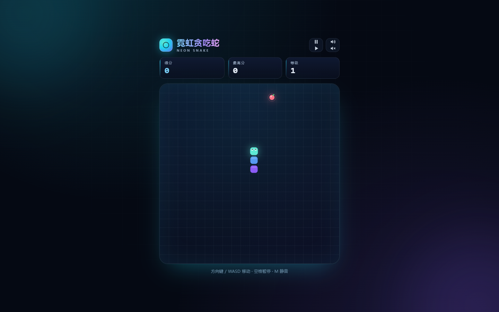

# 霓虹贪吃蛇 · Neon Snake

一个开箱即玩的 HTML5 贪吃蛇小游戏：纯 HTML / CSS / JavaScript，无框架、无依赖、无构建步骤。



## 开始玩

**方式一：直接打开** — 双击 `index.html`（或拖进浏览器）。

**方式二：本地服务** — 需要 Node.js 18+：

```bash
npm start
# 打开 http://127.0.0.1:4173
```

`npm start` 只用 Node 内置模块，不需要先 `npm install`。

## 玩法

- 控制小蛇吃掉粉色光点，每吃一个 +10 分并变长；每吃 5 个升一级，速度随之加快。
- 撞到墙或咬到自己就结束；最高分自动保存在浏览器 `localStorage`。
- 20×20 棋盘，填满即可通关。

## 操作

| 操作 | 键盘 | 触屏 |
| --- | --- | --- |
| 移动 | 方向键 / WASD | 滑动棋盘，或点按屏幕方向键 |
| 暂停 / 继续 | 空格 或 P | 顶部暂停按钮 |
| 开始 / 再来一局 | 空格 / 回车 或按钮 | 点击按钮 |
| 静音 | M 或顶部扬声器按钮 | 顶部扬声器按钮 |

## 已实现的小细节

- Canvas 渲染 + 高 DPI 自适应、响应式方形棋盘。
- 吃掉光点时的粒子飞溅、分数跳动、撞墙震动反馈，尊重 `prefers-reduced-motion`。
- WebAudio 合成音效，可静音并记住偏好。
- 方向输入队列：连续快速转向不会出现“反向自杀”。
- 页面切到后台自动暂停。
- 触屏方向键只在触屏 / 粗指针设备显示。

## 开发

```bash
npm install        # 仅安装端到端测试所需的 playwright-core
npm test           # 游戏逻辑单元测试（node:test）
npm run test:e2e   # 用本机 Chrome 做端到端测试，并重新生成 docs/evidence 截图
```

## 文件

- `index.html` — 页面结构
- `styles.css` — 视觉与响应式布局
- `game.js` — 与渲染无关的游戏逻辑（可在 Node 中直接 require）
- `app.js` — Canvas 渲染、输入、音效、存储
- `scripts/serve.mjs` — 零依赖静态服务器
- `test/` — 单元测试与 Playwright 端到端测试
