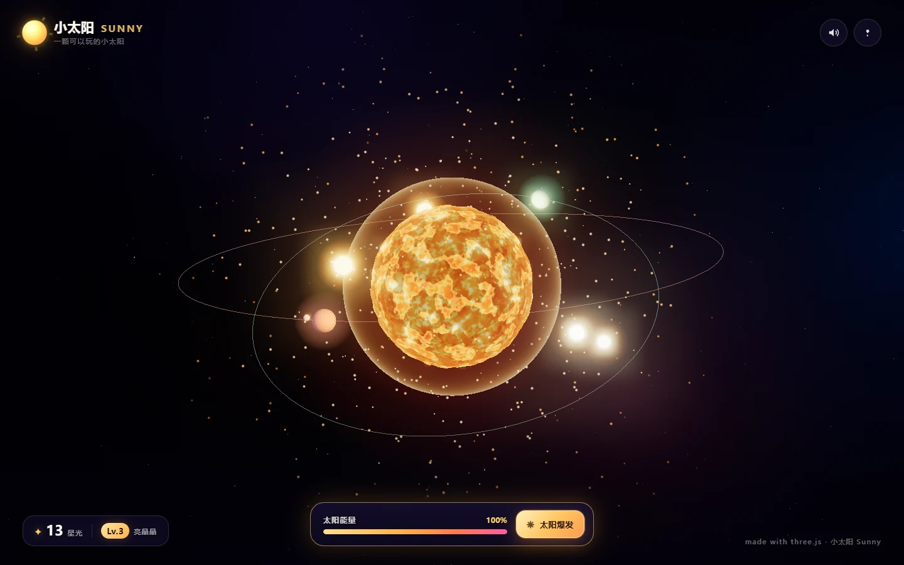

# 小太阳 Sunny

用 three.js 做的 3D 可玩小太阳：拖动旋转宇宙，点击收集星光，把太阳一点点养大；戳一戳会放日冕烟花，能量攒满还能来一场太阳爆发。



## 运行

不需要安装依赖，也没有构建步骤。ES Module 需要通过 HTTP 打开：

```bash
python -m http.server 8000
# 然后打开 http://localhost:8000
```

也可以用 `npx serve .` 或任意静态文件服务器。three.js 0.169 通过 jsDelivr CDN 加载，首次打开需要联网。

## 玩法

- **拖动 / 双指**：旋转视角；**滚轮 / 双指捏合**：拉近拉远；按 `R` 回到初始视角。
- **点击 / 触摸星尘**：收集星光，普通星尘 +1，金色星尘 +3。
- **戳太阳**：放一束日冕烟花（手机支持时会有轻微震动）。
- **能量满格**：点击「太阳爆发」或按 `空格`，触发日冕爆发。
- `M` 静音 / 恢复声音，`H` 打开玩法说明。
- 星光达到 0 / 3 / 8 / 14 / 22 / 32 时升级，共六个等级；每次升级会解锁一颗小行星。
- 进度只保存在当前页面，刷新后从头开始。

## 技术

- three.js r169，ES Module + import map，无框架、无打包器。
- 自定义 GLSL：3D simplex noise / FBM 太阳表面、fresnel 大气、日冕 sprite、太阳风粒子、等离子体日珥。
- `EffectComposer` + `UnrealBloomPass`，ACES filmic tone mapping。
- WebAudio 实时合成音效，没有外部音频资源。
- 响应式布局；移动端会降低部分粒子数量；支持 `prefers-reduced-motion`。

## 目录

```
index.html        页面骨架、启动界面、HUD 与帮助弹窗
styles.css        全部样式和响应式布局
src/main.js       启动、渲染循环、交互、HUD
src/sun.js        太阳表面 shader、日冕、太阳风
src/sky.js        星空、星云与可解锁行星
src/motes.js      星尘生成、漂浮与收集动画
src/fx.js         粒子、冲击波、日珥、爆发
src/camera-rig.js 拖拽/缩放/开场镜头
src/audio.js      WebAudio 音效
src/game.js       等级、能量、爆发状态
```
